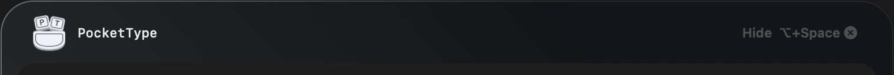
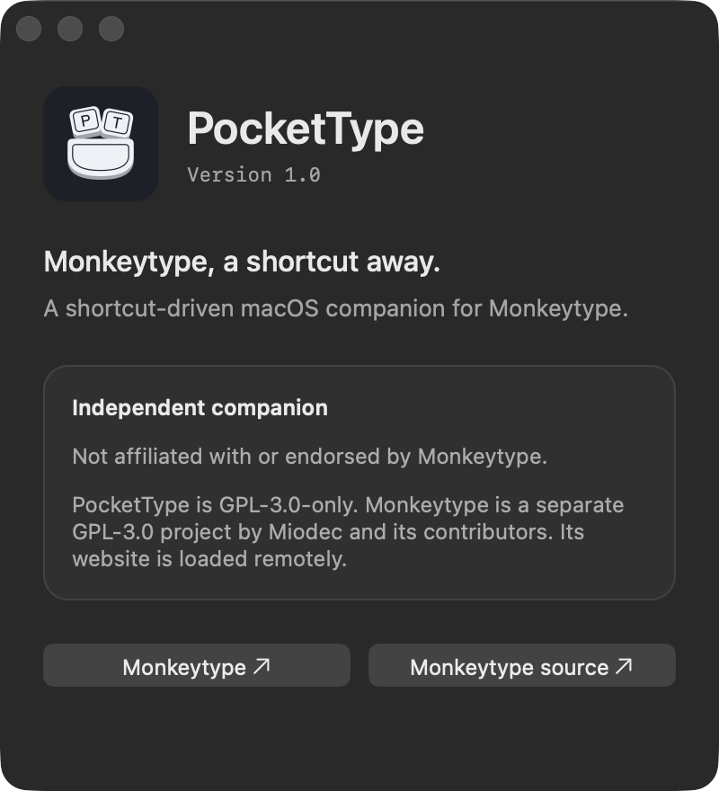

<p align="center">
  
</p>

<h1 align="center">PocketType</h1>

<p align="center"><strong>Monkeytype, a shortcut away.</strong></p>

<p align="center">
  
  
  <a href="LICENSE"></a>
</p>

You're waiting for a build, an AI agent, or your next meeting. You want a little typing practice—not another browser tab to find.

Press **Option–Space**. PocketType brings the real [Monkeytype](https://monkeytype.com) website into a native macOS overlay. Practise, view your results, and hide it with the same shortcut. It stays ready in your menu bar.

PocketType is an independent companion, **not affiliated with or endorsed by Monkeytype**. It isn't an offline clone: Monkeytype still owns the typing engine, modes, themes, scoring, and account history.



## What you get

- **One shortcut, no Dock clutter.** A floating overlay with a smooth entrance and exit. Change the shortcut in Settings.
- **Actual Monkeytype.** Your familiar tests, results, themes, and account—not a second scoring system.
- **A focused view.** No website navbar, footer links, merch banner, or ad slots. Important dialogs and notices remain.
- **Optional glass.** An experimental native frosted background for practice, with live blur, shade, control-opacity, and contrast settings. Other pages retain their normal theme.
- **A window that fits your workflow.** Drag the top to move, drag the edges to resize. Position and size persist; the menu-bar reset gets you back to a sensible default.
- **A persistent session.** The website stays loaded while hidden. Sign in once using the email/password form and enable “remember me.”

<table>
  <tr>
    <td align="center"><br /><sub>Make the glass your own</sub></td>
    <td align="center"><br /><sub>A small native companion</sub></td>
  </tr>
</table>

## Get started

Requires **macOS 14+** and an internet connection. No GitHub account or CLI is needed to use PocketType.

The first downloadable release is being prepared. For now, build from source with the Xcode command-line tools and Swift 6:

```sh
git clone https://github.com/AlexanderHeffernan/PocketType.git
cd PocketType
./build.sh
open build/PocketType.app
```

Move the app into Applications to keep it. Optionally add it under **System Settings → General → Login Items**.

## A few things to know

**Hiding doesn't stop the test.** Monkeytype controls its timers and scoring. Hiding PocketType does not finish or pause a timed test; use the website's normal test/restart controls.

**Sign in with email/password.** Standard ⌘V, ⌘C, ⌘X, and ⌘A work in the login fields. Google blocks embedded-browser sign-in. If you normally use Google, add a password to the same account in Monkeytype's full website under **Account settings → Authentication**, then use it here. Signing in through Safari or Chrome doesn't sign in the app; their sessions aren't shared with WKWebView.

**Glass is experimental and off by default.** It uses an unsupported WebKit background API and reversible CSS. Detected failures restore the normal website background. Future macOS or Monkeytype changes may break it; the normal opaque view remains available. This is not an App Store-safe implementation.

**A live website can change.** PocketType's focused layout depends on Monkeytype's current page structure. If a website change breaks the wrapper, you can always open the full website from the menu bar.

## Privacy

PocketType adds no analytics, app account, or backend. The website loads directly from Monkeytype and remains subject to its own privacy policy and network requests. Login data stays in WebKit's persistent website store; the native shell does not read passwords, tokens, cookies, or your clipboard. Preferences and window placement are stored locally. No screen capture or desktop sampling is used for glass.

The stable bundle identifier is `com.local.drift.typing`, retained from early local builds so preferences and website sessions survive upgrades. Quit old Drift/Monkeytype Quick copies before running PocketType.

## Development

```sh
swift test
./build.sh
codesign --verify --deep --strict build/PocketType.app
```

Native Swift/AppKit shell, WKWebView, and a small Objective-C boundary for the experimental background API. The internal Swift target is still named `Drift`. Editable logo sources are in [`Assets/`](Assets/). See [development notes](docs/DEVELOPMENT.md) for layout, glass behaviour, limitations, and architecture details.

## Contributing

Bug reports and small, focused pull requests are welcome. Include your macOS version and whether glass is enabled. For website issues, check whether the same behaviour occurs on monkeytype.com. See [CONTRIBUTING.md](CONTRIBUTING.md).

## License and attribution

[GPL-3.0-only](LICENSE) © Alexander Heffernan. Monkeytype is a separate GPL-3.0 project by Miodec and its contributors: [upstream source](https://github.com/monkeytypegame/monkeytype). Its website is loaded remotely, not bundled here. Monkeytype's name and branding belong to their respective owners; this licence does not imply endorsement or grant trademark rights.
