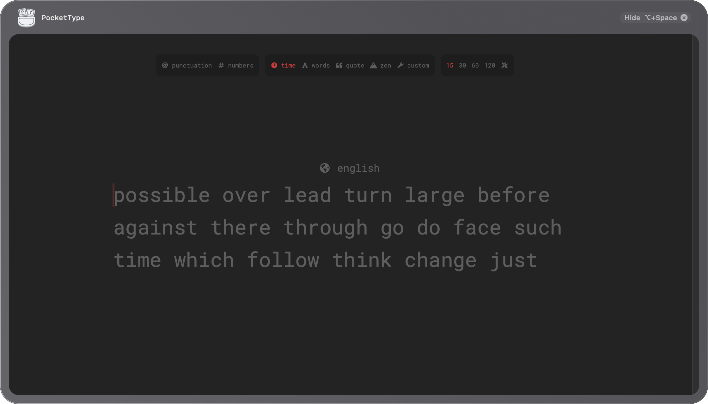
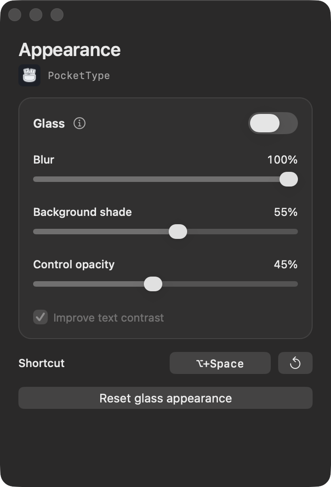
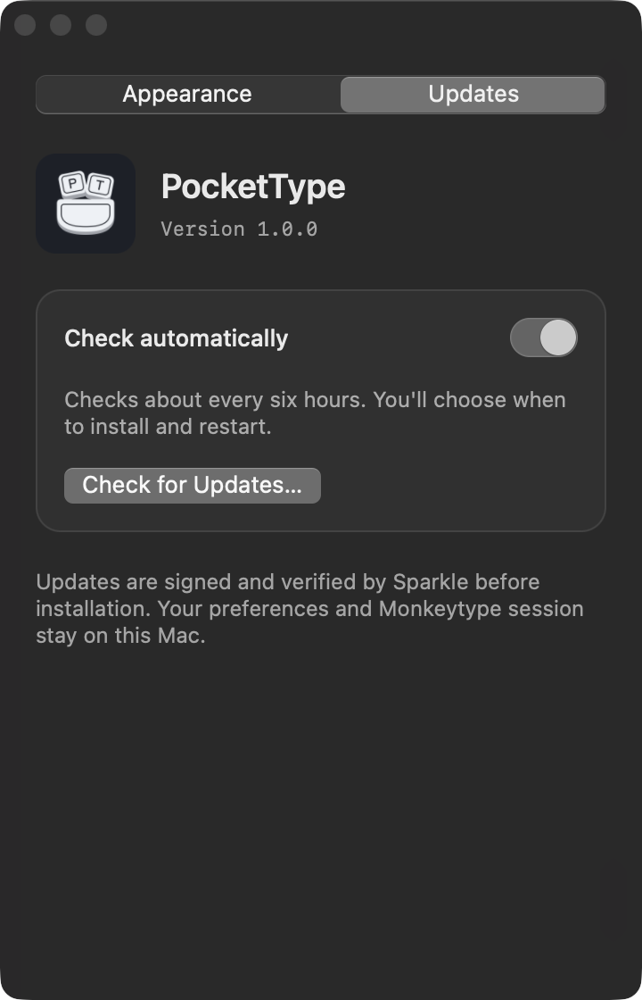

<p align="center">
  
</p>

<h1 align="center">PocketType</h1>

<p align="center">
  <a href="https://github.com/AlexanderHeffernan/PocketType/actions/workflows/release.yml"></a>
  <a href="https://github.com/AlexanderHeffernan/PocketType/releases/latest"></a>
  
  <a href="LICENSE"></a>
</p>

PocketType is a native macOS menu-bar app for [Monkeytype](https://monkeytype.com). Press **Option–Space** to bring up the typing screen, and press it again to hide it.

It loads the real website, so you keep Monkeytype's tests, themes, results, and account history.

## Install

Requires **macOS 14+** and an internet connection. Supports **Apple Silicon and Intel**. No GitHub account, developer tools, or administrator access needed.

Paste this into Terminal:

```sh
curl -fsSL https://raw.githubusercontent.com/AlexanderHeffernan/PocketType/main/install.sh | bash
```

The [installer](install.sh) verifies the release checksum, installs to **`~/Applications`**, and opens PocketType. Press **Option–Space** to practise. It uses no `sudo` and does not remove macOS quarantine.

Prefer to install manually? [Download PocketType.zip](https://github.com/AlexanderHeffernan/PocketType/releases/latest/download/PocketType.zip), unzip it, and move **PocketType.app** into Applications.

**First launch:** releases are not Apple-notarised. If macOS blocks the app, use **System Settings → Privacy & Security → Open Anyway** only if you trust the download. Signed in-app updates do not replace Apple notarisation.



## Features

- **An optional global shortcut.** Change or disable Option–Space in **Settings → Appearance → Shortcut**. Menu-bar access still works when disabled; **⌘W** hides the typing window without resetting the page. No Dock icon.
- **A focused typing screen.** Website navigation, footer links, merch banners, and ad slots are hidden. Tests, results, and important notices remain.
- **Optional glass.** Adjust blur, background shade, control opacity, and text contrast while previewing the practice window.
- **Move and resize.** Drag the header or window edges. Position and size persist, with a reset in the menu-bar menu.
- **Stay signed in.** Use Monkeytype's email/password login with normal copy and paste, and enable “remember me” to keep your session. The website stays loaded while hidden.
- **In-app updates.** Check from Settings or the menu bar, with optional automatic checks and signed downloads.

<table>
  <tr>
    <td align="center"><br /><sub>Appearance</sub></td>
    <td align="center"><br /><sub>Updates</sub></td>
  </tr>
</table>

### Updates and launch at login

Use **Settings → Updates → Check for Updates…**, or **Check for Updates…** in the menu bar. Automatic checks run about every six hours while the app is running and can be disabled. Updates are not silently installed by default.

To start PocketType when you log in, add it under **System Settings → General → Login Items**.

## A few things to know

**Hiding doesn't stop the test.** Monkeytype controls its timers and scoring. Hiding PocketType does not finish or pause a timed test; use the website's normal test/restart controls.

**Sign in with email/password.** Standard ⌘V, ⌘C, ⌘X, and ⌘A work in the login fields. Google blocks embedded-browser sign-in. If you normally use Google, add a password to the same account in Monkeytype's full website under **Account settings → Authentication**, then use it here. Signing in through Safari or Chrome doesn't sign in the app; their sessions aren't shared with WKWebView.

**Glass is experimental and off by default.** It uses an unsupported WebKit background API and reversible CSS. Detected failures restore the normal website background. Future macOS or Monkeytype changes may break it; the normal opaque view remains available. This is not an App Store-safe implementation.

**A live website can change.** PocketType's focused layout depends on Monkeytype's current page structure. If a website change breaks the wrapper, you can always open the full website from the menu bar.

## Privacy

PocketType adds no analytics, app account, or backend. The website loads directly from Monkeytype and remains subject to its own privacy policy and network requests. Login data stays in WebKit's persistent website store; the native shell does not read passwords, tokens, cookies, or your clipboard. Preferences and window placement are stored locally. No screen capture or desktop sampling is used for glass. Update checks contact GitHub for the signed release feed and downloads; Sparkle system profiling is disabled.

The stable bundle identifier is `com.local.drift.typing`, retained from early local builds so preferences and website sessions survive upgrades. Quit old Drift/Monkeytype Quick copies before running PocketType.

## Development

Requires the Xcode command-line tools with Swift 6. To build from source:

```sh
git clone https://github.com/AlexanderHeffernan/PocketType.git
cd PocketType
swift test
./build.sh
codesign --verify --deep --strict build/PocketType.app
open build/PocketType.app
```

Native Swift/AppKit shell, WKWebView, and a small Objective-C boundary for the experimental background API. The internal Swift target is still named `Drift`. Editable logo sources are in [`Assets/`](Assets/). See [development notes](docs/DEVELOPMENT.md) for layout, glass behaviour, limitations, and architecture details.

Pushes to `main` test both Mac architectures and publish a versioned universal release automatically. See [releasing](docs/RELEASING.md) for signing, versioning, and verification, and [third-party notices](THIRD_PARTY_NOTICES.md) for Sparkle and release tooling.

## Contributing

Bug reports and small, focused pull requests are welcome. Include your macOS version and whether glass is enabled. For website issues, check whether the same behaviour occurs on monkeytype.com. See [CONTRIBUTING.md](CONTRIBUTING.md).

## License and attribution

[GPL-3.0-only](LICENSE) © Alexander Heffernan. PocketType is an independent companion, **not affiliated with or endorsed by Monkeytype**. Monkeytype is a separate GPL-3.0 project by Miodec and its contributors: [upstream source](https://github.com/monkeytypegame/monkeytype). Its website is loaded remotely, not bundled here. Monkeytype's name and branding belong to their respective owners; this licence does not imply endorsement or grant trademark rights.
