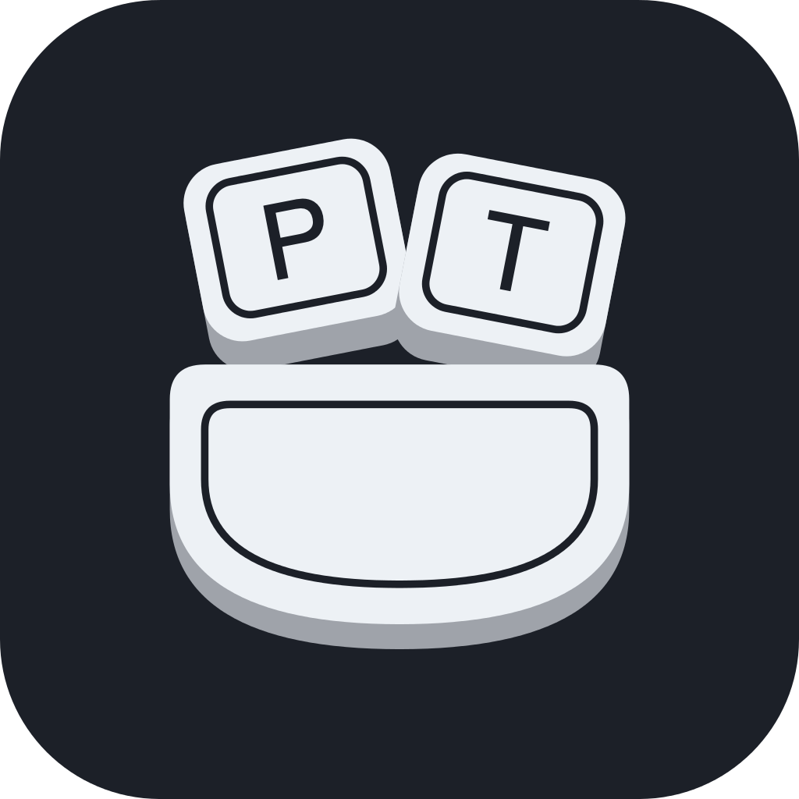

# PocketType



**Monkeytype, a shortcut away.**

An independent, shortcut-driven macOS companion for [Monkeytype](https://monkeytype.com). The real website in a native Swift/AppKit glass overlay, powered by Apple's WKWebView—not an offline clone or separate scoring engine. Not affiliated with or endorsed by Monkeytype.

Requires macOS 14+, an internet connection, and Xcode command-line tools to build.

```sh
./build.sh
open "build/PocketType.app"
```

Drag the app into Applications to keep it. Optionally add it in **System Settings → General → Login Items**. Quit any old Drift or Monkeytype Quick build before launching PocketType. The existing bundle identifier (`com.local.drift.typing`) is deliberately retained to preserve website storage and preferences. The internal Swift target remains `Drift`.

## Usage

- **Option–Space** shows/hides the floating overlay. Drag its top area to move it; drag edges/corners to resize. Size and position save across hides and launches. The default is 1060×600 points, minimum 760×420, maximum 1600×1000 (further limited to the available display). Restored windows are fitted onto a connected display. **Reset overlay size & position** in the menu bar restores a centered default on the screen under your pointer. No title bar or Dock icon.
- Open **Settings…** from the menu-bar icon, or press **⌘,** while the app is active. A compact floating inspector leaves the actual overlay visible while editing. Click the shortcut recorder and press a combination with Option, Control or Command. Escape, switching apps, or closing settings cancels recording. Changes save automatically across launches. Conflicts leave the previous shortcut unchanged; the reset arrow restores Option–Space. Some macOS-reserved shortcuts may still be intercepted by the system.
- **Settings → Glass** reveals native frosted glass on the practice screen only. Results, sign-in, and account screens retain the normal theme background, including during in-page navigation. It is off by default and saves across launches. Hover the information icon for the experimental warning. Turn it off without reloading or losing the current page.
- Glass appearance controls save and update live over a single continuous native surface: **Blur**, **Background shade**, and **Control opacity** all run from 0–100%. Blur blends from a clear desktop backdrop to macOS's full native frosted-glass effect; it does not blur the typing text or set a Gaussian radius. **Improve text contrast** (on by default) uses brighter untyped words, white correct letters, distinct pink errors, a white caret, and subtle text shadows. Turn contrast off to keep exact typing theme colors. Selected toolbar modes retain their theme accent. **Reset glass appearance** restores 100% blur, 55% shade, 45% control opacity, and improved text contrast. While the inspector has focus, practice words remain sharp for preview; closing it restores Monkeytype's usual out-of-focus appearance. This does not pause a test or change its input/scoring. More transparency trades contrast for desktop visibility. No screen capture or desktop sampling is used by the app.
- The same website instance stays alive while hidden. Reopening does not reload or reset it.
- The switch beside **Settings → Appearance → Shortcut** disables global shortcut registration without forgetting the key combination. It is enabled by default and saves across launches. Menu-bar show/hide remains available. Re-enabling a shortcut held by another app leaves it disabled and reports the conflict. **⌘W** closes the focused settings/about window normally, or hides the typing overlay without resetting its page.
- Clicking another app fades the overlay away without stealing focus back. Explicit Hide returns focus after the exit animation finishes. Reduce Motion removes movement.
- Monkeytype owns test modes, themes, shortcuts (including Tab/Escape), scoring, results, and account history. **Hiding does not finish or pause a timed test.**
- The website navbar, footer links, merch banner, and ad slots are hidden. Consent dialogs and important notices remain intact.
- **Sign in** appears in the overlay for guests. Signed-in users have no account button in the overlay; **Sign out** is available only in the menu-bar dropdown. Account state is observed from Monkeytype's own header controls; no credentials, tokens, or session storage are read. The account button stays hidden while state is unknown. Sign out invokes the website's own sign-out button, rather than deleting website data.
- **Practice** appears only away from the practice page and returns to typing. The top-right **Hide ×** control shows the global shortcut when enabled, or **⌘W** when disabled, updating immediately. No refresh button or persistent footer instructions.
- The menu-bar account action reads **Sign in** for guests and **Account** when signed in (or while status is unknown); signed-in users also get **Sign out**. Account opens the account page when signed in. **Open MonkeyType** opens the full website in your regular browser. Menu actions use matching native icons; **About PocketType** contains attribution and licence information. Other non-test pages also open in your regular browser. No independent WPM display or local score uploads.

## Sign-in

Use Monkeytype's **email/password** form inside the app. **⌘V Paste**, **⌘C Copy**, **⌘X Cut**, and **⌘A Select All** use the standard macOS responder chain. Copy credentials from your password manager and paste into the fields; the native shell does not read the clipboard or inject pasted text. Monkeytype's typing-test paste restrictions remain unchanged.

Leave **remember me** enabled to retain the session in WebKit's persistent website store. Password-manager autofill integrations are not guaranteed. **Google blocks embedded-browser sign-in.** For Google accounts, add a password to the same account through **Account settings → Authentication** in your regular browser, then use that email/password here. Do not create another account.

Browser sign-in does not sign this app in: Safari/Chrome and WKWebView do not share storage, and Monkeytype exposes no supported browser-to-native authorization handoff. There is no token/cookie extraction or user-agent spoofing. ApeKeys are not a website login or supported result-submission alternative.

Guests receive results without saving to an online account. Real authenticated sign-in, sign-out, and saved results still require verification with a real account; automated checks simulate the public account controls without submitting credentials. Normal Monkeytype terms, privacy rules, and network requests apply.

## Development

```sh
swift test
./build.sh
codesign --verify --deep --strict "build/PocketType.app"
```

The approved logo source is [Assets/PocketType.svg](../Assets/PocketType.svg). The app includes a multi-resolution macOS icon and matching artwork in About and Appearance. The overlay header uses a tightly cropped, transparent [mark](../Assets/PocketTypeMark.svg) at 32 points, without the app-icon tile. A dedicated [menu-bar glyph](../Assets/MenuBarIcon.svg) uses simplified, full-contrast shapes at 24 × 22 points and adapts to macOS's light/dark appearance. PNG resources and the `.icns` are included, so building needs no SVG renderer or image-generation tools.

The native shell uses behind-window frosted glass with a reflective rim. By default the website retains its theme-colored canvas. The opt-in glass experiment uses WebKit's unsupported `_setDrawsBackground:` / `_drawsBackground` API plus reversible, origin-scoped CSS. A small Objective-C boundary checks selectors and method signatures, verifies the setting, and catches Objective-C exceptions (which Swift cannot catch). After applying CSS, the app checks computed canvas backgrounds. Detected API/CSS failures turn the experiment off, restore normal drawing and the opaque theme canvas, and explain the fallback in settings. A terminated website process also disables the experiment before reloading. macOS Reduce Transparency blocks/disables the experiment and makes the native surface opaque.

This does not make private API supported or App Store-safe, even when the option is off. It cannot guarantee recovery from every possible macOS/WebKit crash or detect every visual/theme issue. The experiment is intended for local/open-source distribution and can be switched off manually if it looks wrong. Website custom-background images are suppressed only during glass practice; inputs, dialogs, and result controls retain their own styling. Practice detection observes the visible typing area and result state as well as the route, rather than treating every screen on `/` as a test.

The Carbon global shortcut needs no Accessibility or Input Monitoring permission; reserved shortcuts and secure-input contexts can restrict it.

DOM integration handles Monkeytype's current mounted header/footer and direct upstream layout. Future website changes may require updating selectors for chrome, authentication detection, or sign-out. Input, scoring, and result submission remain the website's responsibility.

## Open source and attribution

This wrapper is licensed under **GPL-3.0-only**; see [LICENSE](../LICENSE). Monkeytype is a separate project by Miodec and its contributors, with its own [source and GPL-3.0 license](https://github.com/monkeytypegame/monkeytype). Its website code is loaded remotely, not bundled here. Monkeytype's name and branding belong to their respective owners; this license does not grant trademark rights or imply endorsement.
